# Resumo da Análise Descritiva — GestRisk CCF

## Modelo em uso

| Item | Valor |
|------|-------|
| **Modelo** | CatBoost |
| **Experimento** | experimento_3_completo (36 features) |
| **Balanceamento** | class_weight |
| **Dataset** | `dataset_com_id_gestante.csv` |
| **Gestantes** | 5,000 |
| **Prevalência real de CCF** | 7.4% |

## 1. Análise do dataset

- **Idade materna média:** 28.4 anos (DP 6.4)
- **IMC médio:** 25.5 kg/m²
- **Idade gestacional média:** 20.1 semanas
- **Gestação gemelar:** 2.4%

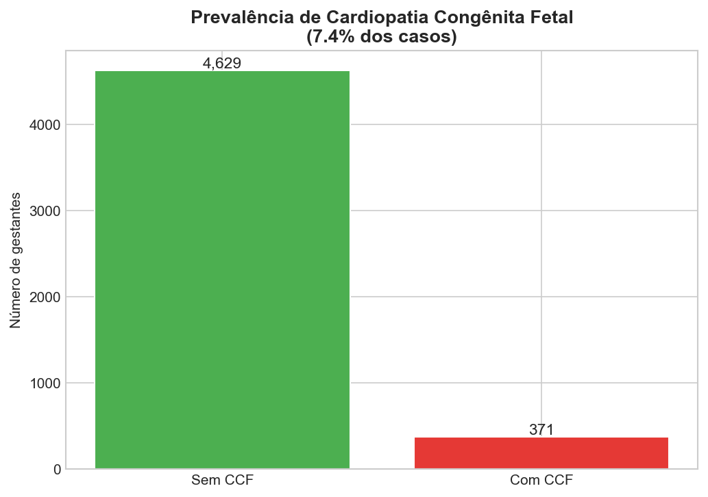

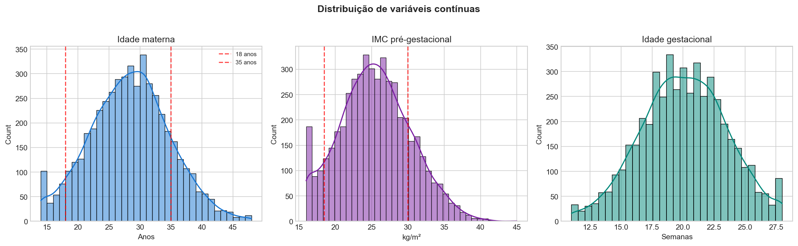

**Resumo:** O dataset é desbalanceado (~7% CCF), típico de triagem fetal. A maioria das gestantes tem idade e IMC dentro da faixa habitual.

## 2. Análise de fatores de risco

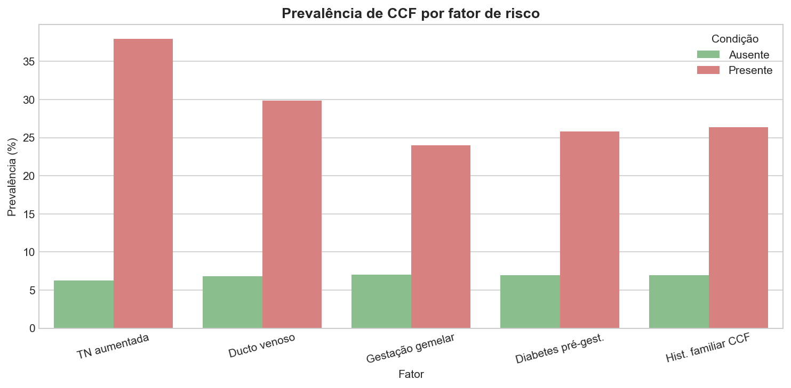

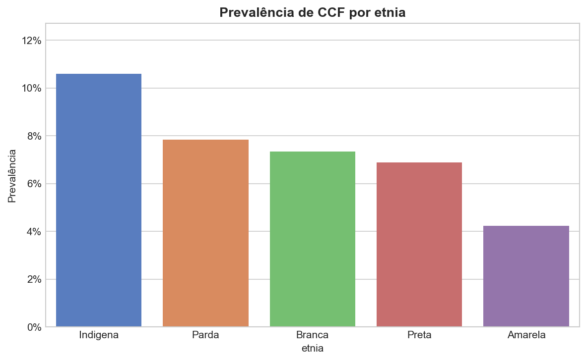

**Resumo:** Marcadores fetais (TN aumentada, ducto venoso) e histórico familiar concentram maior prevalência de CCF quando presentes.

## 3. Análise de intercorrências (API)

- **Média de intercorrências por gestante:** 1.5
- **Total de intercorrências detectadas:** 7,423

**Por categoria:**

- Dados maternos: 3,523
- Marcadores fetais: 1,341
- Doenças maternas: 1,017
- Hábitos: 941
- Exposição ambiental: 229
- Infecções: 172
- Condições gestacionais: 158
- Medicações teratogênicas: 42

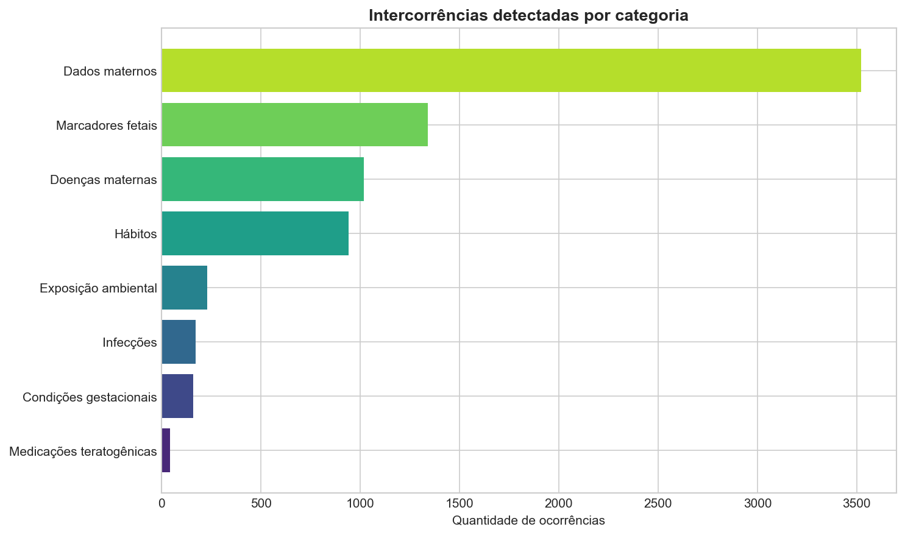

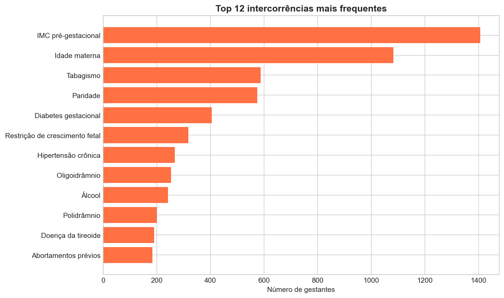

**Resumo:** Cada gestante é analisada campo a campo. As intercorrências são as alterações clínicas detectadas — é nelas que estão os sinais de risco individual.

## 4. Análise preditiva do modelo

- **Risco baixo:** 39 (0.8%)
- **Risco moderado:** 3,211 (64.2%)
- **Risco alto:** 1,750 (35.0%)

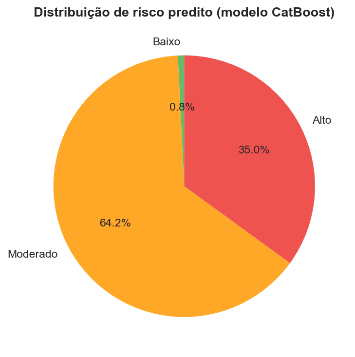

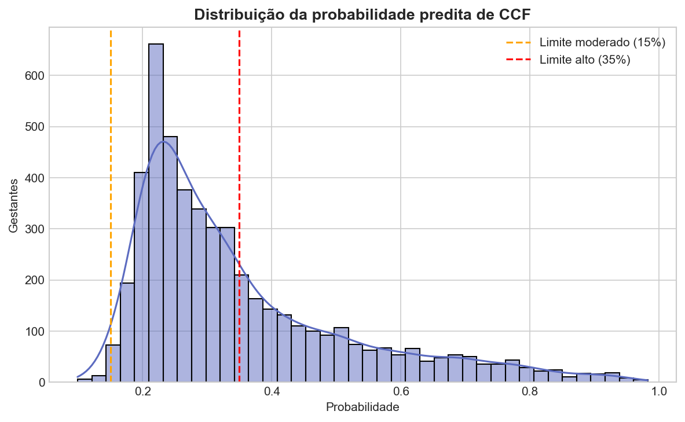

**Resumo:** O modelo CatBoost estima probabilidade contínua de CCF. Limiares: <15% baixo, 15–35% moderado, ≥35% alto.

## 5. Priorização de ecocardiograma fetal

- **Recomendam ecocardiograma:** 4,969 (99.4%)
- **Urgente:** 107
- **Alta:** 572
- **Moderada:** 1,045
- **Baixa:** 3,276

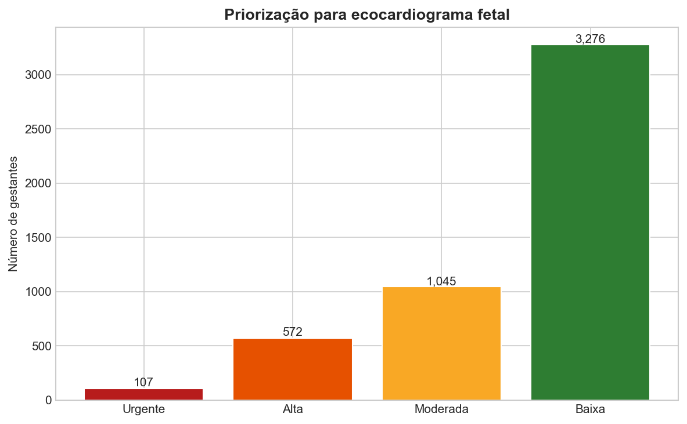

**Resumo:** A fila prioriza gestantes com marcadores fetais, alta probabilidade do modelo ou múltiplas intercorrências.

## 6. Performance do modelo (pipeline)

| Métrica | Validação cruzada | Teste |
|---------|-------------------|-------|
| F1-Score | 0.359 | 0.349 |
| ROC-AUC | 0.790 | 0.804 |
| Sensibilidade | 0.596 | 0.608 |
| Especificidade | 0.861 | 0.850 |

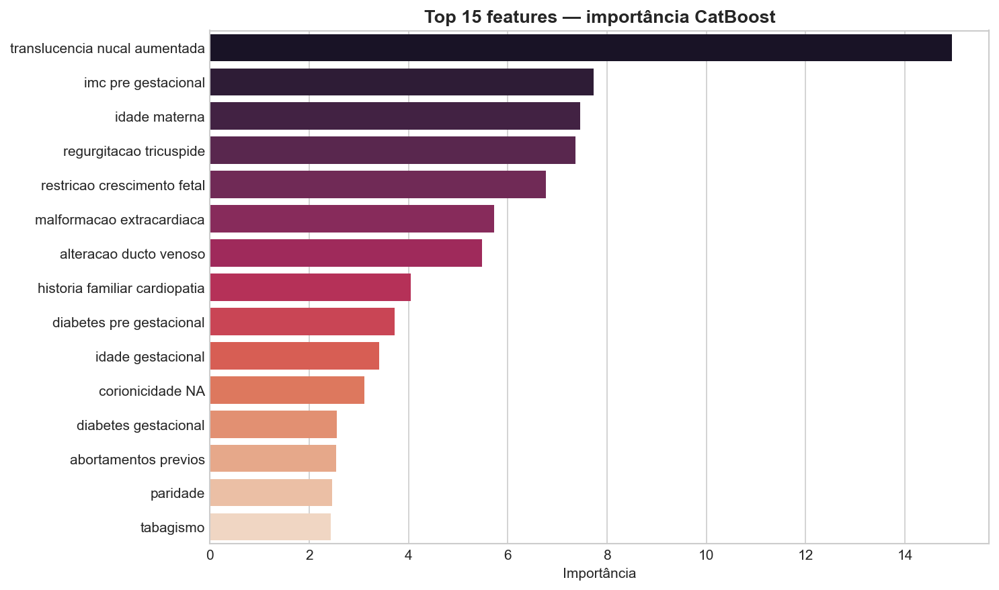

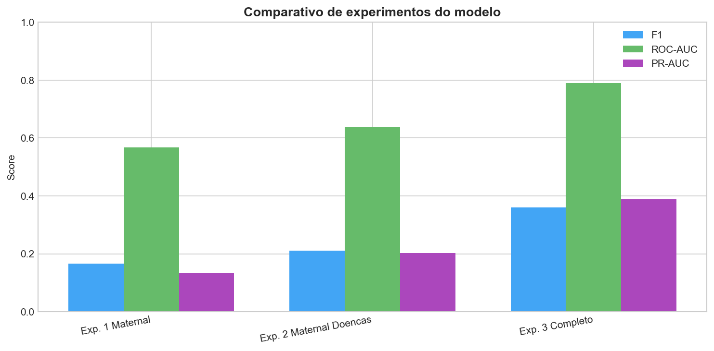

**Resumo:** O experimento completo (36 variáveis) supera os demais. Marcadores fetais são as features mais importantes.

## Gráficos gerados

- `02_distribuicao_idade_imc.png` — distribuicao
- `11_prevalencia_por_etnia.png` — etnia
- `10_comparativo_experimentos.png` — experimentos
- `03_ccf_por_fatores_risco.png` — fatores_risco
- `09_importancia_features.png` — importancia
- `04_intercorrencias_por_categoria.png` — intercorrencias_cat
- `01_prevalencia_ccf.png` — prevalencia
- `08_prioridade_ecocardiograma.png` — prioridade_eco
- `07_distribuicao_probabilidade.png` — probabilidade
- `06_distribuicao_risco.png` — risco
- `05_top_intercorrencias.png` — top_intercorrencias